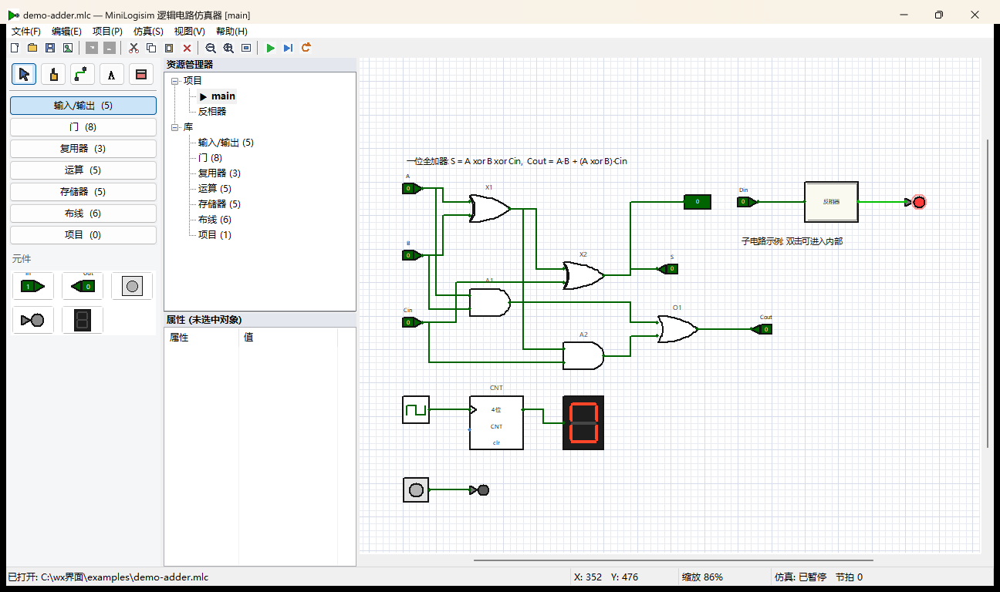

# 逻辑电路仿真器（wxWidgets / C++）

一个参考 **Logisim 2.7.1** 界面与操作方式编写的数字逻辑电路设计与仿真软件，
使用 **C++17 + wxWidgets 3.2.2.1** 开发，可直接在 **Visual Studio 2022** 中打开、编译、调试。

> 生成的可执行文件名为 `逻辑电路仿真器.exe`（工程文件名 `MiniLogisim.vcxproj` 未改）。
> 想换名字只改 `MiniLogisim.vcxproj` 里的 `<TargetName>` 一行即可。



---

## 1. 功能一览

| 分类 | 内容 |
| --- | --- |
| **元件库** | 输入/输出 5 种、门电路 8 种、复用器 3 种、运算器 5 种、存储器 5 种、布线 6 种，共 32 种元件 |
| **仿真内核** | 并查集网络归并 + 迭代收敛求解；组合逻辑实时传播，时钟节拍驱动时序元件；可检测组合环振荡 |
| **层次设计** | 一个工程可包含多张电路图，任意电路都可作为“子电路”元件被其它电路调用（自动展开参与仿真） |
| **编辑功能** | 放置、框选、拖动、旋转、复制/粘贴/剪切/副本、删除、撤销/重做（120 级）、属性表编辑 |
| **布线** | 逐点布线、自动吸附栅格与引脚、T 型搭接自动连通、交叉不连通（与 Logisim 一致）、隧道、分线器 |
| **观察手段** | 导线上色显示逻辑值、引脚电平圆点、探针、LED、七段数码管、按钮、输入引脚可交互翻转 |
| **其它** | 多页资源管理器、组合逻辑真值表生成、导出 PNG 图片、命令行无界面导出、内置使用说明 |

支持的元件：

* **输入/输出**：输入引脚、输出引脚、按钮、LED、十六进制数码管
* **门**：非门、与门、或门、与非门、或非门、异或门、同或门、缓冲器（输入端口数 2~8 可调、位宽 1~32 可调）
* **复用器**：多路选择器、多路分配器、译码器
* **运算**：加法器、减法器、比较器、移位器、乘法器
* **存储器**：D 触发器、寄存器、计数器、随机存储器 RAM、只读存储器 ROM
* **布线**：时钟、常量、隧道、探针、分线器、文本
* **项目库**：工程内自定义子电路

---

## 2. 环境要求

| 项目 | 版本 |
| --- | --- |
| 操作系统 | Windows 10 / 11 (x64) |
| 编译器 | Visual Studio 2022（工具集 v143），需安装“使用 C++ 的桌面开发” |
| 库 | wxWidgets **3.2.2.1**，x64 + Unicode + **静态库**、**Debug** 配置 |

本工程默认 wxWidgets 安装在 `C:\wxWidgets-3.2.2.1`，库目录为
`C:\wxWidgets-3.2.2.1\lib\vc_x64_lib`（其中的库文件形如 `wxmsw32ud_core.lib`、
`wxbase32ud.lib`，即 Debug/Unicode/静态库）。

> 本机 wxWidgets 只编译了 **Debug** 版静态库，因此工程提供 Debug / Release 两个配置，
> 但两者都使用 Debug 版 wxWidgets（`/MDd` + `*ud.lib`）。
> 如需真正的 Release：先编译 wxWidgets 的 Release 库
> （`cd C:\wxWidgets-3.2.2.1\build\msw` 然后
> `nmake /f makefile.vc BUILD=release SHARED=0 TARGET_CPU=X64`），
> 再把 `MiniLogisim.vcxproj` 中的 `WX_SUFFIX` 改为空、`WX_CFG` 相关项与
> `RuntimeLibrary` 改为 `MultiThreadedDLL` 即可。

### 如果 wxWidgets 装在别的位置

改 `MiniLogisim.vcxproj` 顶部的这一行即可（或设置同名环境变量）：

```xml
<WX_ROOT Condition="'$(WX_ROOT)'==''">C:\wxWidgets-3.2.2.1</WX_ROOT>
```

---

## 3. 编译与运行

### 方式一：Visual Studio 2022（推荐）

1. 双击打开 `MiniLogisim.sln`；
2. 选择配置 **Debug | x64**；
3. 按 `F7` 生成，`Ctrl+F5` 运行；
4. 生成结果：`bin\Debug\MiniLogisim.exe`。

### 方式二：MSBuild 命令行

```bat
"C:\Program Files\Microsoft Visual Studio\2022\Community\MSBuild\Current\Bin\MSBuild.exe" ^
    MiniLogisim.sln /p:Configuration=Debug /p:Platform=x64 /m
```

（本机 VS 安装在 `D:\vs2022`，对应路径为
`D:\vs2022\MSBuild\Current\Bin\amd64\MSBuild.exe`；也可直接运行 `build.bat`。）

### 命令行参数

```
MiniLogisim.exe [选项] [电路文件.mlc]

  --export=<文件.png>   不打开界面，直接把电路渲染成 PNG 后退出
  --ticks=<n>           导出前先仿真的时钟节拍数（默认 0）
  --circuit=<i>         指定导出第 i 张电路图（从 0 开始）
```

示例（把示例工程仿真 13 个节拍后导出图片）：

```bat
MiniLogisim.exe --ticks=13 --export=out.png examples\demo-adder.mlc
```

---

## 4. 快速上手

1. **放元件**：左侧“元件”面板里先点一个库（如“门”），再点一个元件，
   然后在画布上单击放置；可连续放置，按 `Esc` 取消。
2. **连线**：点工具条上的“布线”工具，在引脚上单击开始，逐点单击转折，
   **双击 / 右键 / Esc** 结束一条导线。导线会自动吸附栅格和引脚。
3. **看结果**：`Ctrl+E` 启用仿真（或点工具条 ▶ 按钮）。
   导线颜色即电平：**亮绿=1，暗绿=0，蓝色=悬空，红色=冲突/错误**。
4. **改输入**：选“查探”工具，单击输入引脚即可翻转电平（多位引脚 `Shift+单击` 按位循环）；
   按住“按钮”元件不放则该元件输出 1。
5. **加子电路**：“项目”菜单 → “添加电路”，画好输入/输出引脚后，
   在“项目”库里就会出现对应的子电路元件，可直接放置使用。
   在画布上**双击**子电路元件可进入其内部。
6. **存盘**：`Ctrl+S` 保存为 `.mlc` 工程文件（纯文本、UTF-8）。

示例工程：

* `examples/demo-adder.mlc` — 一位全加器 + 时钟计数器 + 子电路（反相器）
* `examples/demo-mux-rom.mlc` — 4 选 1 多路选择器 + ROM 查表

---

## 5. 快捷键

| 快捷键 | 功能 |
| --- | --- |
| `Ctrl+N` / `Ctrl+O` / `Ctrl+S` / `Ctrl+Shift+S` | 新建 / 打开 / 保存 / 另存为 |
| `Ctrl+Z` / `Ctrl+Y` | 撤销 / 重做 |
| `Ctrl+X` / `Ctrl+C` / `Ctrl+V` / `Ctrl+D` | 剪切 / 复制 / 粘贴 / 创建副本 |
| `Delete` | 删除选中对象 |
| `Ctrl+A` / `Esc` | 全选 / 取消选择（并结束当前布线） |
| 方向键 / `Ctrl+方向键` | 移动选中对象 10 像素 / 1 像素 |
| `R` | 顺时针旋转选中元件 |
| `Ctrl+=` / `Ctrl+-` / `Ctrl+0` / `Ctrl+1` | 放大 / 缩小 / 适应窗口 / 实际大小 |
| `Ctrl+G` | 显示/隐藏栅格 |
| `Ctrl+E` / `Ctrl+T` / `Ctrl+R` | 启用或暂停仿真 / 单步一个节拍 / 复位仿真 |
| 鼠标中键拖动 | 平移画布 |
| 滚轮 / `Ctrl+滚轮` | 滚动 / 缩放 |

---

## 6. 目录结构

```
MiniLogisim.sln / .vcxproj      VS2022 工程与解决方案
build.bat                       一键命令行编译脚本
res/app.rc                      资源脚本（引入 wx.rc，含 comctl32 v6 清单）
src/
  App.h/.cpp                    应用程序入口、命令行解析、无界面导出模式
  Ids.h                         命令 ID 集中定义
  LogicModel.h/.cpp             数据模型：元件/引脚/连线/电路/文档、几何、属性、序列化
  Simulator.h/.cpp              仿真内核：层次展开、网络归并、迭代求值、时钟节拍
  Renderer.h/.cpp               全部元件的矢量绘图（画布与工具图标共用）
  CanvasPanel.h/.cpp            画布：绘制、栅格、缩放、框选、放置、布线、查探、右键菜单
  ToolBoxPanel.h/.cpp           左侧元件库与工具面板
  SidePanel.h/.cpp              资源管理器（多电路树）与属性表
  MainFrame.h/.cpp              主窗口：菜单、工具条、状态栏、仿真定时器、文件读写、撤销栈
  Dialogs.h/.cpp                属性编辑、真值表、关于、使用说明对话框
tools/
  simtest.cpp / SimTest.vcxproj 仿真内核无界面自测程序（30+ 项断言）
examples/*.mlc                  示例工程
docs/*.png                      界面截图
```

---

## 7. 仿真内核自测

`tools/SimTest.vcxproj` 是一个控制台自测程序，它直接编译 `LogicModel.cpp` 与
`Simulator.cpp`，对内核做确定性验证（不依赖界面）：

```bat
msbuild tools\SimTest.vcxproj /p:Configuration=Debug /p:Platform=x64 /p:SolutionDir=%CD%\
bin\Debug\SimTest.exe
```

覆盖内容：与/或/非门真值表、一位全加器全 8 种输入组合、时钟+计数器节拍序列、
多位宽与分线器位段、隧道连通、D 触发器边沿锁存、子电路层次、存盘/读盘往返。
全部通过时输出 `全部通过 (失败 0 项)`。

---

## 8. 工程文件格式

`.mlc` 为 UTF-8 纯文本，一行一条记录，便于版本管理与脚本生成：

```
VERSION 1
CIRCUIT name="main"
  WIRE pts="130,110;160,110;160,130;200,130"
  COMP id=1 type=0 x=100 y=100 face=0 bits=1 inputs=2 sel=1 addr=4 fan=2 bw=1 flags=0 val=0 sub=-1 label="A" text=""
ENDCIRCUIT
```

* `type` 为元件类型号（0 输入引脚、1 输出引脚、2 按钮、3 LED、4 数码管、5 非门、6 与门、
  7 或门、8 与非门、9 或非门、10 异或门、11 同或门、12 缓冲器、13 多路选择器、
  14 多路分配器、15 译码器、16 加法器、17 减法器、18 比较器、19 移位器、20 乘法器、
  21 D 触发器、22 寄存器、23 计数器、24 RAM、25 ROM、26 时钟、27 常量、28 隧道、
  29 探针、30 分线器、31 文本、32 子电路）
* `face`：0 东、1 西、2 北、3 南；栅格步长 10 像素
* `flags`：bit0 = 触发沿(0 上升沿/1 下降沿) 或移位方向(0 左/1 右)，bit1 = 计数方向
* `sub`：子电路元件所引用的电路序号
* 坐标均为相对画布原点的整数像素

---

## 9. 实现要点提示（二次开发）

> **想自己写一个「运行时动态元件库」（不改代码、随时新增元件）？**
> 请先读 [扩展指南-动态元件库.md](docs/扩展指南-动态元件库.md)：
> 里面列了 15 处必改点、5 条不变式、骨架代码与逐项自测清单。

* **新增元件**：在 `LogicModel.h` 的 `CompType` 中加枚举 → 在 `LogicModel.cpp` 的
  `g_meta` 表加名称/说明/所属库 → 在 `Document::Size()`、`Document::Pins()` 中给出
  尺寸与引脚布局 → 在 `Renderer::DrawComponent()` 中加绘制分支 →
  在 `Simulator::Evaluate()` 中加求值分支 → 需要属性时在 `GetAttrDefs()` 中登记。
* **引脚坐标体系**：所有元件都以“输出朝东”的局部坐标描述，`LocalToWorld()` /
  `WorldToLocal()` 负责按朝向旋转，绘制、命中测试、仿真共用同一套变换。
* **网络归并**：`Simulator::Rebuild()` 把导线顶点、元件引脚、隧道展开到并查集，
  再对“落在其它线段上的点”做搭接判断，因此 T 型连接会自动连通、十字交叉不会连通。
* **时序元件**：求值阶段只更新“下一状态”，`Tick()` 中检测时钟沿后才真正锁存，
  因此可以正确处理边沿触发与反馈回路。

---

## 10. 已知限制

* 仿真以**当前打开的电路图**为根展开子电路；打开子电路页时该页作为独立根仿真
  （便于单独调试，但与父页共享的寄存器状态是分开的）。
* 组合环只做有限次迭代（120 次）并在状态栏提示“检测到振荡”，不做更精细的时序分析。
* 位宽上限 32 位；RAM/ROM 容量上限 1024 项（地址位宽 ≤ 10）。
* 由于本机 wxWidgets 只有 Debug 静态库，发布版请按第 2 节自行编译 Release 库。
